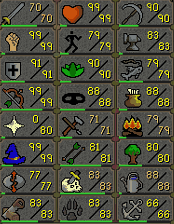

# The Other Half

Level 92 is halfway to 99 in experience. The first half of the grind gives you 91 level ups. The second half gives you 7.

This resets the skills tab at 92 so you climb 1 to 92 again on the way to 99.

Second-half levels are tinted so you can tell them from real ones, and hovering a skill still shows the real one. Level ups get the game's own sound and fireworks. Progress bars are optional and cover every skill.

BSD-2-Clause.
